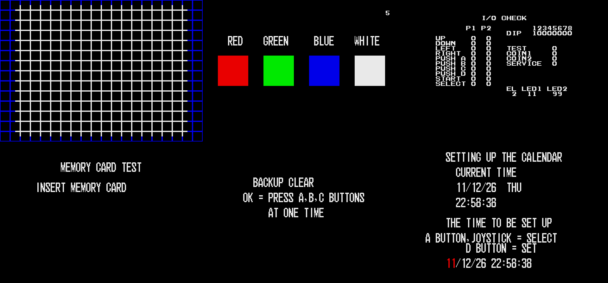
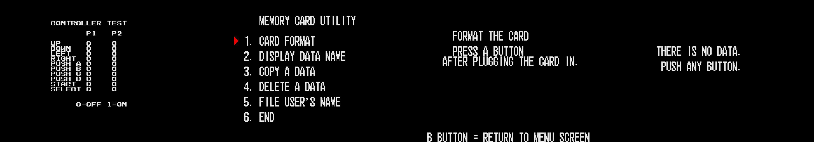

# Neo-Geo-sp-s2-Bios-disassembly

Disassembly of the Neo Geo MVS system ROM **SP-S2** (Europe MVS V2, the default BIOS in MAME), with a
source tree that rebuilds the ROM byte for byte. The long-term goal is a custom system ROM built on it.

**Status: L0, L1 and L5 done, L4 nearly (30 backup RAM accesses left), L2 measured (48.2 % of the code
ran in MAME), naming in progress (157 names)** (2026-11-13): `src/sp-s2.s` assembles to the original
ROM (SHA-1 below); the BIOS has been run in MAME (screens below, levels in the table).

## ROM map

One pixel per byte, coloured by type (`tools/rom_map.py`); bright blue code ran in MAME in at least
one of the coverage scenarios. Full ROM:


Used bytes only (free space folded, 256 bytes per row), with the named tables:


## Screens

SP-S2 rebuilt from `src/` is byte-identical, so these MAME 0.264 captures show this code
(`tools/mame_run.lua`, HOWTO section 7). Boot sequence: start-up screen, the NEO·GEO logo animation,
"MAX 330 MEGA / PRO-GEAR SPEC", SNK logo:


Test mode ("Setting Mode" DIP on): main menu, hardware test (crosshatch), hard DIP, soft DIP (cabinet),
book keeping, code number, calendar:


Hardware test: START steps from the crosshatch to the colour bars, the I/O check (inputs, DIP switches,
credit LED counters), the sound test, the memory card test and the backup RAM clear:



Hidden programs: SP-S2 contains a controller test and a MEMORY CARD UTILITY (format, display data
names, copy, delete, user name) that nothing in the ROM calls (`$C14EA2-$C16AA9`, no call, jump or
pointer to them). A test build (`tools/hidden_programs_test.py`) points two test-menu items at them;
both still work in MAME:



Memory card in MAME: Sengoku 2 played by a bot (`tools/mame_bot_sengoku2.lua`) reaches its second
area; losing there brings the game's SAVE prompt (CARD save), a new game with that card offers LOAD and
resumes in the second area (CARD load), and the card utility deletes the data (CARD delete):


Relocation test (`tools/relocation_test.py`): a modified build where the main code has moved and a
new routine prints a line under the test menu; the boot sequence and the hardware test still work:


## BIOS calls used by games

`tools/scan_bios_calls.py` counts references to each BIOS call slot in a game's program ROM
(MAME order, first program ROM only: code in a second bank such as `p2` is not scanned). Checked so far:

| Game | SYSTEM_RETURN | SYSTEM_IO | CREDIT_CHECK | CREDIT_DOWN | READ_CALENDAR | CARD | CARD_ERROR | HOW_TO_PLAY | FIX_CLEAR | LSP_1ST | MESS_OUT |
|---|---|---|---|---|---|---|---|---|---|---|---|
| Sengoku 2 | 5 | 1 | 1 | 0 | 0 | 7 | 1 | 0 | 0 | 0 | 0 |
| NAM-1975 | 7 | 1 | 6 | 0 | 0 | 3 | 2 | 1 (ran in MAME) | 2 | 2 | 0 |
| Cyber-Lip | 4 | 1 | 1 | 0 | 0 | 3 | 1 | 0 | 0 | 0 | 0 |
| Magician Lord | 5 | 3 | 1 | 1 (unused wrapper) | 1 | 1 | 1 | 0 | 0 | 0 | 0 |
| The King of Fighters '94 | 7 | 1 | 2 | 0 | 0 | 1 | 1 | 0 | 0 | 33 | 0 |
| Neo Bomberman | 16 | 1 | 1 | 0 | 0 | 0 | 0 | 0 | 1 | 0 | 0 |
| King of the Monsters 2 | 2 | 1 | 7 | 1 (ran in MAME) | 0 | 6 | 1 | 0 | 0 | 14 | 0 |
| Viewpoint | 4 | 2 | 2 | 0 | 0 | 1 | 1 | 0 | 1 | 0 | 2 |
| Alpha Mission II | 4 | 1 | 4 | 0 | 0 | 4 | 2 | 0 | 0 | 6 | 0 |
| Robo Army | 6 | 1 | 2 | 0 | 0 | 3 | 2 | 0 | 0 | 0 | 0 |
| Last Resort | 3 | 1 | 7 | 0 | 0 | 3 | 1 | 0 | 0 | 0 | 0 |
| Crossed Swords | 6 | 3 | 2 | 0 | 0 | 2 | 2 | 0 | 3 | 1 | 0 |
| Fatal Fury | 3 | 1 | 2 | 0 | 1 | 5 | 4 | 0 | 0 | 0 | 0 |
| Eight Man | 4 | 1 | 3 | 0 | 0 | 3 | 1 | 0 | 0 | 1 | 0 |
| Riding Hero | 9 | 1 | 2 | 0 | 0 | 7 | 3 | 0 | 0 | 0 | 0 |
| Mahjong Kyoretsuden | 4 | 1 | 2 | 0 | 0 | 3 | 2 | 1 (ran in MAME) | 0 | 0 | 0 |
| Top Player's Golf | 6 | 1 | 2 | 1 | 0 | 10 | 4 | 0 | 0 | 0 | 0 |
| Baseball Stars Professional | 6 | 1 | 3 | 1 | 0 | 7 | 1 | 1 (ran in MAME) | 0 | 0 | 0 |

Every game also holds `ENTRY_RESET` and `SYSTEM_INT1` once (its own vector table); none references
SYSTEM_INT2, SETUP_CALENDAR, CHECKSUM_LOOP or CONTROLLER_SETUP.

None of them points its level 2 (HBL) interrupt vector at SYSTEM_INT2 (KOF '94 leaves it at 0).
Top Player's Golf and Baseball Stars Professional reference CREDIT_DOWN (not run yet). Two other
games call it in their code: Magician Lord only from an unused wrapper, and King of the
Monsters 2 when one player selects PLAYER1 PLAYER2 vs COMPUTER: the game takes the second player's
credit itself with CREDIT_CHECK then CREDIT_DOWN (a P2 START join or a continue go through the BIOS
start handling instead):


HOW_TO_PLAY as called by
NAM-1975 (the BIOS animates the joystick and buttons, the captions come from the game):


### SYSTEM_INT2 (level 2 timer interrupt)

`SystemInt2` (`$C118CA`, slot `$C0043E`) is the level 2 entry of the system ROM's own vector table:
it acknowledges the LSPC timer interrupt and turns it off (`REG_LSPCMODE = $4000`). It only runs when
a timer interrupt arrives while the system ROM vectors are mapped (C). Every BIOS path that maps them
first masks interrupts and, except one, writes `REG_LSPCMODE = $4000` or runs before the game starts.
The exception is HOW_TO_PLAY (`$C18914`): it maps the system ROM vectors at `$C18956` and lowers the
mask at `$C18962` without touching `REG_LSPCMODE`. A game that leaves a raster (timer) effect on and
calls HOW_TO_PLAY gets its next timer interrupt here, which shuts the timer off for the BIOS screen (I).

Checked in MAME with `tools/mame_watch_irq2.lua` (debugger watchpoints, 3,000 to 4,000 frames of
attract, coin and START, 18 games): Sengoku 2 (`$08D0`), Viewpoint (`$00D8`), Eight Man (`$00D0`, in
attract) and Top Player's Golf (`$0F50`) turn the timer interrupt on, and none of them calls
HOW_TO_PLAY. The three games that call it (NAM-1975, Mahjong Kyoretsuden, Baseball Stars
Professional) do so after START with the timer off (last `REG_LSPCMODE` write `$4000` or `$0800`).
Riding Hero contains a `$00D0` write that did not run in this window. So no checked game runs
SystemInt2 by itself. Forcing it: a debugger breakpoint at `$C1895C` (just after the vector switch in
HOW_TO_PLAY) turns the timer interrupt on as such a game would; SystemInt2 then runs once and the
HOW_TO_PLAY screen goes on normally (scenario `nam1975_how_to_play_timer_irq`):

```
MAME=mame MAME_ROMS=mame/roms tools/mame_coverage.sh nam1975_how_to_play_timer_irq nam1975 LAST=1720 \
  KEYS="1500:Coin 1,1530:Coin 1,1600:1 Player Start" \
  'DEBUG_CMDS=bpset c1895c,1,{w@3c0006=0030; w@3c0008=0; w@3c000a=1000; g}'
```

A real case needs a game that calls HOW_TO_PLAY with a timer effect on at that moment; none is
known. Later games stopped calling HOW_TO_PLAY and handle their raster interrupts with their own
vectors, so SystemInt2 is most likely an unused safety net (I).

## Contents

| File | What it is |
|---|---|
| [`src/`](src/) | Generated 68000 source (GNU as, Motorola syntax), ROM addresses in comments: `sp-s2.s` includes 14 modules (`header.s`, `tables.s`, `boot.s`, `system.s`, `power_on.s`, `calendar.s`, `card.s`, `boot_error.s`, `hardware_test.s`, `eyecatcher.s`, `video_io.s`, `how_to_play.s`, `test_mode.s`, `data_end.s`) |
| [`src/neogeo.inc`](src/neogeo.inc), [`src/ram.inc`](src/ram.inc) | Registers, cartridge header, `A5_BASE`/`A4_BASE`; every RAM address used |
| [`Makefile`](Makefile) | `make`, `make check`, `make fixsum`, `make source` |
| [`HOWTO.md`](HOWTO.md) | Requirements, build, regeneration, trace hints, how to modify and test the BIOS |
| [`ROADMAP.md`](ROADMAP.md) | What is left for the disassembly, in order: coverage, names, RAM, written reference, other SNK ROMs |
| [`SKILL.md`](SKILL.md) | Working playbook: ROM facts, levels L0-L6, pipeline, pitfalls, rules |
| [`tools/trace.py`](tools/trace.py) | Recursive-descent tracer (Capstone): code, data and free bytes |
| [`tools/gen_source.py`](tools/gen_source.py) | Writes `src/` from the ROM and loops until the rebuild is identical |
| [`tools/symbols.py`](tools/symbols.py) | Loads and checks the names in `symbols/*.csv` (duplicates, tags) |
| [`tools/romtool.py`](tools/romtool.py) | Byte swap, SHA-1 check, boot checksum check and fix |
| [`tools/stats.py`](tools/stats.py) | Counts behind the level table |
| [`tools/hints.txt`](tools/hints.txt) | Manual tracer hints (the card utility pointer tables) |
| [`tools/mame_run.lua`](tools/mame_run.lua) | MAME autoboot script: headless screenshots, test mode, joystick taps |
| [`docs/`](docs/) | ROM byte maps and screenshots of the BIOS running in MAME |
| [`symbols/`](symbols/) | Names (`rom_names`, `ram`, `registers`, `cart_header`), named regions and module boundaries (`modules.csv`), tagged W / C / I / ? |
| [`coverage/`](coverage/) | Executed system ROM addresses of each MAME scenario (`tools/mame_coverage.sh`) |
| [`tools/coverage.py`](tools/coverage.py) | Compares MAME coverage with the static trace |
| [`tools/rom_map.py`](tools/rom_map.py) | Draws the ROM byte maps |
| [`tools/relocation_test.py`](tools/relocation_test.py) | Builds a modified BIOS with moved code and an added routine (L5 test) |
| [`tools/scan_bios_calls.py`](tools/scan_bios_calls.py) | Counts BIOS call references in game program ROMs |
| [`tools/mame_bot_sengoku2.lua`](tools/mame_bot_sengoku2.lua) | MAME play bot for Sengoku 2 (reaches level 2, card save/load) |
| [`tools/hidden_programs_test.py`](tools/hidden_programs_test.py) | Builds a test BIOS whose test menu opens the unreferenced controller test and card utility |
| [`tools/mame_trace.lua`](tools/mame_trace.lua), [`tools/mame_coverage.sh`](tools/mame_coverage.sh) | Traced MAME runs (debugger trace through a FIFO; extra debugger commands with `DEBUG_CMDS`) |
| [`tools/mame_watch_irq2.lua`](tools/mame_watch_irq2.lua) | Logs a game's timer IRQ settings, vector switches and SystemInt2 runs |

The ROM is **not** in the repository (SNK copyright). Put your own dump in `roms/` (git-ignored).

## Building

```
make check    # build/sp-s2.sp1, SHA-1 must be 4f5ed7105b7128794654ce82b51723e16e389543
```

Needs Python 3 with `capstone` and GNU binutils for m68k (`binutils-m68k-linux-gnu`). Details in
[`HOWTO.md`](HOWTO.md).

## Disassembly status

| Level | State |
|---|---|
| L0 source rebuilds the ROM | done: SHA-1 `4f5ed710...` and boot checksum `$4D`; 9,109 instructions, 2 kept as raw words because GNU as would encode them as `moveq` |
| L1 every byte typed | done by the tracer: code 32,338 B, data 22,011 B (text as `.ascii`, ROM pointers as `dc.l label`), free 76,723 B; three numeric tables identified (scaling tables at `$C02000`/`$C03000`, sine table at `$C04000`, tag I); the unreferenced controller test and memory card utility traced from their pointer tables (`tools/hints.txt`) |
| L2 code traced and run | 15 code-pointer tables followed; indirect jumps: `jmp (a6)` at `$C131A8` (return through a6 during the RAM test) the only one left (`tools/stats.py`); the card utility dispatch at `$C150A6` is found by the tracer. MAME, 25 scenarios with 4 games (Sengoku 2: boot, coins and START, hardware test, test-mode items, calendar set, memory card blank/formatted, card utility in a test build, played by a bot to level 2 then save, load and delete; NAM-1975: HOW_TO_PLAY, and HOW_TO_PLAY with the timer interrupt forced on; Magician Lord: start; King of the Monsters 2: P2 join, continue, co-op start): 4,386 of 9,109 instructions ran (48.2 %); nothing ran outside the static trace. All 8 CARD functions and HOW_TO_PLAY ran. SYSTEM_INT2 ran only when forced (see above). CREDIT_DOWN ran with King of the Monsters 2. Never run: the checksum slot, the alternate calendar path, the boot error screens and the work RAM test loop (all hard DIPs on) |
| L3 names | 157 routines, tables and data blocks named in `symbols/rom_names.csv`: the 17 BIOS call slots (wiki names, W) and their targets, and the 8 CARD functions; all ran in MAME except the checksum slot (SYSTEM_INT2 only when forced); boot path, system modes and the hand-off to the game, VBlank and SYSTEM_IO, start buttons, credits and their deduction, slot switching, calendar chip (and an alternate calendar path, never run), test mode, hardware test, the unreferenced controller test and memory card utility, the most-called helpers (C from code reading, MAME screens and coverage); some I. 1,424 automatic labels left |
| L4 RAM and registers | no raw RAM, register or cartridge-header operand left; `x(a5)` written `(NAME-A5_BASE,a5)`; backup RAM through a4 = `$D08000` written `(NAME-A4_BASE,a4)` where a4 is proven (30 accesses left raw where a4 cannot be proven). 216 RAM addresses used: 50 named (W/C/I), 166 automatic; 4 `move.l #$100000` left as numbers (start of work RAM used as the card buffer); 18 cartridge header fields named |
| L5 editable tree | done: 14 modules (`symbols/modules.csv`), no numeric ROM address left, free space as `.org`. Relocation proven in MAME (`tools/relocation_test.py`): with two NOPs at `Reset` and a new routine called from `TestMenu`, 38,961 bytes move and the BIOS still boots, plays the boot animation, starts Sengoku 2, runs the test menu (with the new line) and the hardware test |
| L6 understanding | started: boot sequence, every test-mode and hardware-test screen, the hidden programs, card save/load/delete, HOW_TO_PLAY, CREDIT_DOWN and SYSTEM_INT2 run in MAME and linked to their routines (README sections above); screen texts match the ROM text tables (for example book keeping "CABINET/COIN" at `$C1AEB2`); no written reference per subsystem yet |

## Sources

- NeoGeoDev wiki: [System ROM](https://wiki.neogeodev.org/index.php/System_ROM), [BIOS calls](https://wiki.neogeodev.org/index.php/BIOS_calls),
  [Memory mapped registers](https://wiki.neogeodev.org/index.php/Memory_mapped_registers), [68k ASM defines](https://wiki.neogeodev.org/index.php/68k_ASM_defines),
  [BIOS RAM locations](https://wiki.neogeodev.org/index.php?title=BIOS_RAM_locations), [Boot process](https://wiki.neogeodev.org/index.php/Boot_process).
- [MAME `neogeo.cpp`](https://github.com/mamedev/mame/blob/master/src/mame/snk/neogeo.cpp): ROM hashes and board notes.
- [Capstone](https://www.capstone-engine.org/) (disassembly) and GNU binutils (assembly).
- Method from the [Game Boy Printer](https://github.com/Raphael-Boichot/Game-Boy-Printer-disassembly) and
  [Game Boy Camera](https://github.com/Raphael-Boichot/Game-Boy-Camera-disassembly) disassemblies (levels L0-L6, C / I / ? tags).

## Licence

The tools, labels, comments and documents are GPLv3 (`LICENSE`). The ROM contents, and so the
instructions and data in `src/sp-s2.s`, remain SNK's: they are not covered by that licence.
