# WORK IN PROGRESS 

# Neo Geo sp-s2 bios disassembly

Disassembly of the Neo Geo MVS system ROM **SP-S2** (Europe MVS V2, the default BIOS in MAME), with a
source tree that rebuilds the ROM byte for byte. The long-term goal is a custom system ROM built on it, maybe.

**Status: L0, L1, L4 and L5 done, L2 measured (87.4 % of the code
ran in MAME, 70.9 % without forced runs), L3 names done for routines and data (574 names, 13 still
inferred, listed with the 15 inferred RAM names in `symbols/doubts.csv`; only `loc_` labels left automatic)** (2026-11-15): `src/sp-s2.s` assembles to the original
ROM (SHA-1 below); the BIOS has been run in MAME (screens below, levels in the table).

## ROM map

One pixel per byte, coloured by type (`tools/rom_map.py`); bright blue code ran in MAME in at least
one of the coverage scenarios. Full ROM:

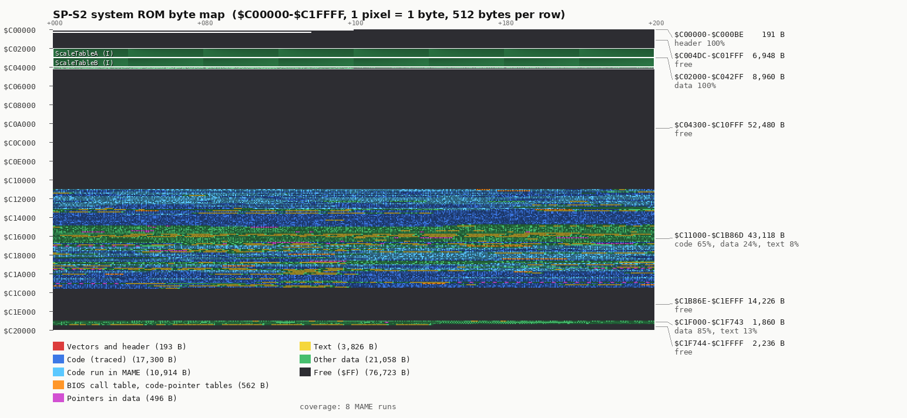

Used bytes only (free space folded, 256 bytes per row), with the named tables:

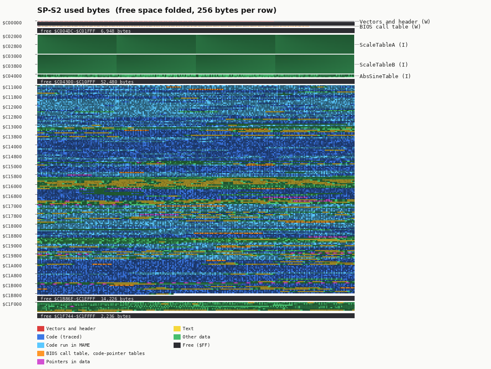

## Screens

SP-S2 rebuilt from `src/` is byte-identical, so these MAME 0.264 captures show this code
(`tools/mame_run.lua`, HOWTO section 7). Boot sequence: start-up screen, the NEO·GEO logo animation,
"MAX 330 MEGA / PRO-GEAR SPEC", SNK logo:


Test mode ("Setting Mode" DIP on): main menu, hardware test (crosshatch), hard DIP, soft DIP (cabinet),
book keeping, code number, calendar:

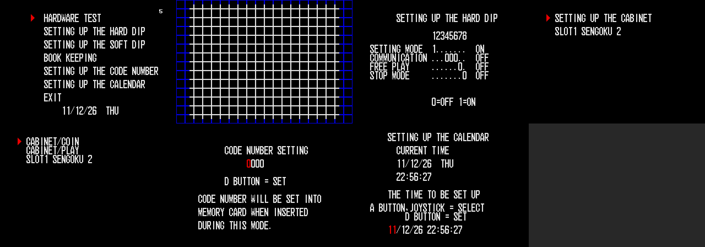

Hardware test: START steps from the crosshatch to the colour bars, the I/O check (inputs, DIP switches,
credit LED counters), the sound test, the memory card test and the backup RAM clear:


Hidden programs: SP-S2 contains a controller test and a MEMORY CARD UTILITY (format, display data
names, copy, delete, user name) that nothing in the ROM calls (`$C14EA2-$C16197`, no call, jump or
pointer to them; the debug monitor follows at `$C16198-$C16AA9`). They are the AES boot menus
(docs/versions.md). A test build (`tools/hidden_programs_test.py`) points two test-menu items at them;
both still work in MAME:


Memory card in MAME: Sengoku 2 played by a bot (`tools/mame_bot_sengoku2.lua`) reaches its second
area; losing there brings the game's SAVE prompt (CARD save), a new game with that card offers LOAD and
resumes in the second area (CARD load), and the card utility deletes the data (CARD delete):

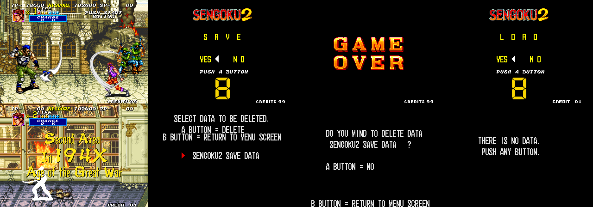

Relocation test (`tools/relocation_test.py`): a modified build where the main code has moved and a
new routine prints a line under the test menu; the boot sequence and the hardware test still work:


## Games used

Game sets (MAME names) used for the MAME runs and the BIOS call scan, by NGH number
(`CART_NGH`, the BCD word at `$108` of the cartridge program header):

| NGH | Game | MAME set | Used for |
|---|---|---|---|
| 001 | NAM-1975 | `nam1975` | HOW_TO_PLAY (also with the timer IRQ forced on), SYSTEM_INT2 check |
| 002 | Baseball Stars Professional | `bstars` | BIOS call scan, HOW_TO_PLAY and timer IRQ check, CREDIT_DOWN with the US country code (forced) |
| 003 | Top Player's Golf | `tpgolf` | BIOS call scan, timer IRQ check, soft DIP time field (test mode), CREDIT_DOWN with the US country code (forced) |
| 004 | Mahjong Kyoretsuden | `mahretsu` | BIOS call scan, HOW_TO_PLAY and timer IRQ check |
| 005 | Magician Lord | `maglord` | game start, CREDIT_DOWN wrapper, timer IRQ check |
| 006 | Riding Hero | `ridhero` | BIOS call scan, timer IRQ check, soft DIP time fields (test mode) |
| 007 | Alpha Mission II | `alpham2` | BIOS call scan, timer IRQ check, soft DIP count fields (test mode) |
| 010 | Cyber-Lip | `cyberlip` | BIOS call scan, timer IRQ check |
| 011 | The Super Spy | `superspy` | BIOS call scan, timer IRQ check |
| 014 | Mutation Nation | `mutnat` | BIOS call scan, timer IRQ check |
| 016 | King of the Monsters | `kotm` | co-op mode: CREDIT_DOWN, BIOS call scan, timer IRQ check |
| 017 | Sengoku | `sengoku` | BIOS call scan, timer IRQ check |
| 018 | Burning Fight | `burningf` | BIOS call scan, timer IRQ check |
| 019 | League Bowling | `lbowling` | game type choice: CREDIT_DOWN, blank and write-protected card (CARD_ERROR), BIOS call scan, timer IRQ check |
| 020 | Ghost Pilots | `gpilots` | BIOS call scan, timer IRQ check |
| 021 | Puzzled / Joy Joy Kid | `joyjoy` | BIOS call scan, timer IRQ check |
| 022 | Blue's Journey | `bjourney` | BIOS call scan, timer IRQ check, CREDIT_CHECK every frame, unused CREDIT_DOWN wrapper |
| 023 | Quiz Daisousa Sen | `quizdais` | BIOS call scan, timer IRQ check |
| 024 | Last Resort | `lresort` | BIOS call scan, timer IRQ check |
| 024 | Last Resort (prototype) | `lresortp` | prototype in the `lresort` set (P ROM in two byte halves): BIOS call scan, timer IRQ check |
| 025 | Eight Man | `eightman` | BIOS call scan, timer IRQ check |
| 032 | Robo Army | `roboarmy` | BIOS call scan, timer IRQ check |
| 033 | Fatal Fury | `fatfury1` | BIOS call scan, timer IRQ check |
| 037 | Crossed Swords | `crsword` | BIOS call scan, timer IRQ check |
| 039 | King of the Monsters 2 | `kotm2` | P2 join, continue, CREDIT_DOWN, timer IRQ check |
| 040 | Sengoku 2 | `sengoku2` | boot, every test-mode screen, 1M card format and save, hardware test, card save/load/delete (bot), NEO-CLN and N0O0G0O0 IDs, boot errors and debug monitor (forced), card utility COPY and controller test (test build), timer IRQ check |
| 051 | Viewpoint | `viewpoin` | BIOS call scan, timer IRQ check |
| 055 | The King of Fighters '94 | `kof94` | BIOS call scan, timer IRQ check |
| 093 | Neo Bomberman | `neobombe` | BIOS call scan, timer IRQ check |
| - | (no cartridge) | `neogeo` | 1M card recovery (Service held at power-on), hardware test crosshatch |

## BIOS calls used by games

`tools/scan_bios_calls.py` counts references to each BIOS call slot in a game's program ROM
(MAME order, first program ROM only: code in a second bank such as `p2` is not scanned). Checked so far,
by NGH number (the game's number in its cartridge header, `CART_NGH` at `$108`):

| NGH | Game | SYSTEM_RETURN | SYSTEM_IO | CREDIT_CHECK | CREDIT_DOWN | READ_CALENDAR | CARD | CARD_ERROR | HOW_TO_PLAY | FIX_CLEAR | LSP_1ST | MESS_OUT |
|---|---|---|---|---|---|---|---|---|---|---|---|---|
| 001 | NAM-1975 | 7 | 1 | 6 | 0 | 0 | 3 | 2 | 1 (ran in MAME) | 2 | 2 | 0 |
| 002 | Baseball Stars Professional | 6 | 1 | 3 | 1 | 0 | 7 | 1 | 1 (ran in MAME) | 0 | 0 | 0 |
| 003 | Top Player's Golf | 6 | 1 | 2 | 1 | 0 | 10 | 4 | 0 | 0 | 0 | 0 |
| 004 | Mahjong Kyoretsuden | 4 | 1 | 2 | 0 | 0 | 3 | 2 | 1 (ran in MAME) | 0 | 0 | 0 |
| 005 | Magician Lord | 5 | 3 | 1 | 1 (unused wrapper) | 1 | 1 | 1 | 0 | 0 | 0 | 0 |
| 006 | Riding Hero | 9 | 1 | 2 | 0 | 0 | 7 | 3 | 0 | 0 | 0 | 0 |
| 007 | Alpha Mission II | 4 | 1 | 4 | 0 | 0 | 4 | 2 | 0 | 0 | 6 | 0 |
| 010 | Cyber-Lip | 4 | 1 | 1 | 0 | 0 | 3 | 1 | 0 | 0 | 0 | 0 |
| 011 | The Super Spy | 4 | 1 | 1 | 0 | 0 | 6 | 2 | 0 | 0 | 0 | 0 |
| 014 | Mutation Nation | 4 | 3 | 2 | 0 | 0 | 7 | 2 | 0 | 1 | 0 | 0 |
| 016 | King of the Monsters | 3 | 1 | 8 | 4 (ran in MAME) | 0 | 6 | 2 | 0 | 0 | 0 | 0 |
| 017 | Sengoku | 2 | 1 | 2 | 0 | 0 | 7 | 1 | 0 | 0 | 0 | 0 |
| 018 | Burning Fight | 3 | 1 | 2 | 0 | 0 | 6 | 5 | 0 | 3 | 2 | 0 |
| 019 | League Bowling | 2 | 1 | 3 | 1 (ran in MAME) | 0 | 7 | 3 | 0 | 13 | 0 | 0 |
| 020 | Ghost Pilots | 4 | 1 | 3 | 0 | 2 | 4 | 2 | 0 | 1 | 1 | 0 |
| 021 | Puzzled / Joy Joy Kid | 3 | 1 | 1 | 0 | 0 | 6 | 0 | 0 | 5 | 0 | 2 |
| 022 | Blue's Journey | 5 | 2 | 1 | 1 | 1 | 1 | 1 | 0 | 0 | 0 | 0 |
| 023 | Quiz Daisousa Sen | 2 | 1 | 3 | 0 | 0 | 1 | 1 | 0 | 0 | 0 | 1 |
| 024 | Last Resort | 3 | 1 | 7 | 0 | 0 | 3 | 1 | 0 | 0 | 0 | 0 |
| 024 | Last Resort (prototype) | 3 | 1 | 7 | 0 | 0 | 3 | 1 | 0 | 0 | 0 | 0 |
| 025 | Eight Man | 4 | 1 | 3 | 0 | 0 | 3 | 1 | 0 | 0 | 1 | 0 |
| 032 | Robo Army | 6 | 1 | 2 | 0 | 0 | 3 | 2 | 0 | 0 | 0 | 0 |
| 033 | Fatal Fury | 3 | 1 | 2 | 0 | 1 | 5 | 4 | 0 | 0 | 0 | 0 |
| 037 | Crossed Swords | 6 | 3 | 2 | 0 | 0 | 2 | 2 | 0 | 3 | 1 | 0 |
| 039 | King of the Monsters 2 | 2 | 1 | 7 | 1 (ran in MAME) | 0 | 6 | 1 | 0 | 0 | 14 | 0 |
| 040 | Sengoku 2 | 5 | 1 | 1 | 0 | 0 | 7 | 1 | 0 | 0 | 0 | 0 |
| 051 | Viewpoint | 4 | 2 | 2 | 0 | 0 | 1 | 1 | 0 | 1 | 0 | 2 |
| 055 | The King of Fighters '94 | 7 | 1 | 2 | 0 | 0 | 1 | 1 | 0 | 0 | 33 | 0 |
| 093 | Neo Bomberman | 16 | 1 | 1 | 0 | 0 | 0 | 0 | 0 | 1 | 0 | 0 |

Every game also holds `ENTRY_RESET` and `SYSTEM_INT1` once (its own vector table; King of the Monsters
holds `SYSTEM_INT1` twice); none references SYSTEM_INT2, SETUP_CALENDAR, CHECKSUM_LOOP or
CONTROLLER_SETUP. The Last Resort prototype (`lresortp`) gives the same counts as the release.

None of them points its level 2 (HBL) interrupt vector at SYSTEM_INT2. (An earlier version of this
page said KOF '94 leaves it at 0: the scan read the wrong half of its 2 MB program ROM; it is `$32C3A`.)
Top Player's Golf and Baseball Stars Professional call CREDIT_DOWN only when the game's copy of
BIOS_COUNTRY_CODE is 1 (USA; Top Player's Golf copies the word `$10FD82` to `$1001F0`, Baseball Stars
`$10FD83` to `$100006`). SP-S2 is a European system ROM (`SystemRegion` = 2), so this never happens
with it. With the code forced to 1 when the game copies it (scenarios `tpgolf_us_credit_down`,
`bstars_us_credit_down`), START takes no credit and the game takes it itself when play begins
(CREDIT_CHECK, then CREDIT_DOWN: credits 07 -> 06, C for the forced run). Blue's Journey (C code with
one wrapper per BIOS call) has no call, jump or pointer to its CREDIT_DOWN wrapper at `$9872`; it calls
CREDIT_CHECK every frame to show which player can start. Magician Lord calls it only from an unused
wrapper. It ran in MAME with three games (C):
League Bowling when the game type is chosen after SELECT PLAY MODE (scenario `lbowling_credit_down`),
and King of the Monsters and King of the Monsters 2 when one player selects PLAYER1 PLAYER2 vs
COMPUTER: the game takes the second player's credit itself with CREDIT_CHECK then CREDIT_DOWN (a P2
START join or a continue go through the BIOS start handling instead; scenarios
`kotm_coop_credit_down`, `kotm2_coop_credit_down`):

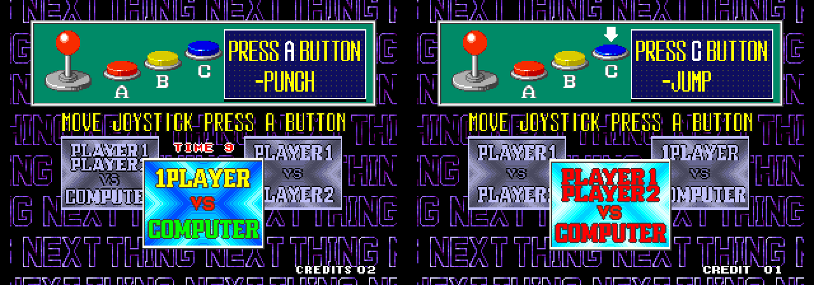

HOW_TO_PLAY as called by
NAM-1975 (the BIOS animates the joystick and buttons, the captions come from the game):

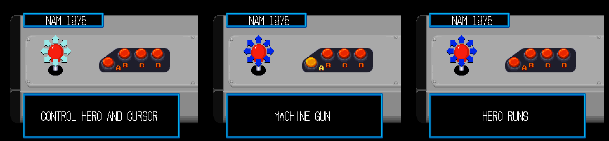

### SYSTEM_INT2 (level 2 timer interrupt)

`SystemInt2` (`$C118CA`, slot `$C0043E`) is the level 2 entry of the system ROM's own vector table:
it acknowledges the LSPC timer interrupt and turns it off (`REG_LSPCMODE = $4000`). It only runs when
a timer interrupt arrives while the system ROM vectors are mapped (C). Every BIOS path that maps them
first masks interrupts and, except one, writes `REG_LSPCMODE = $4000` or runs before the game starts.
The exception is HOW_TO_PLAY (`$C18914`): it maps the system ROM vectors at `$C18956` and lowers the
mask at `$C18962` without touching `REG_LSPCMODE`. A game that leaves a raster (timer) effect on and
calls HOW_TO_PLAY gets its next timer interrupt here, which shuts the timer off for the BIOS screen (I).

Checked in MAME with `tools/mame_watch_irq2.lua` (debugger watchpoints, 3,000 to 4,000 frames of
attract, coin and START, 29 sets): Sengoku 2 (`$08D0`), Viewpoint (`$00D8`), Eight Man (`$00D0`, in
attract) and Top Player's Golf (`$0F50`) turn the timer interrupt on, and none of them calls
HOW_TO_PLAY. The three games that call it (NAM-1975, Mahjong Kyoretsuden, Baseball Stars
Professional) do so after START with the timer off (last `REG_LSPCMODE` write `$4000` or `$0800`).
Riding Hero contains a `$00D0` write that did not run in this window. None of the twelve sets added
later (NGH 011-024 and the Last Resort prototype) turns the timer interrupt on or calls HOW_TO_PLAY.
So no checked game runs
SystemInt2 by itself. Forcing it: a debugger breakpoint at `$C1895C` (just after the vector switch in
HOW_TO_PLAY) turns the timer interrupt on as such a game would; SystemInt2 then runs once and the
HOW_TO_PLAY screen goes on normally (scenario `nam1975_how_to_play_timer_irq`):

```
MAME=mame MAME_ROMS=mame/roms tools/mame_coverage.sh nam1975_how_to_play_timer_irq nam1975 LAST=1720 \
  KEYS="1500:Coin 1,1530:Coin 1,1600:1 Player Start" \
  'DEBUG_CMDS=bpset c1895c,1,{w@3c0006=0030; w@3c0008=0; w@3c000a=1000; g}'
```

A real case needs a game that calls HOW_TO_PLAY with a timer effect on at that moment; none is
known. Later games stopped calling HOW_TO_PLAY and handle their raster interrupts with their own
vectors, so SystemInt2 is most likely an unused safety net (I).

### Test mode settings

Every test-mode screen has been driven in MAME with `tools/test_mode_scenarios.py` (key sequences,
DIP switch changes and memory cards, one coverage scenario each). Keys: Up/Down move, A and B change
a value (held: repeat), Left/Right pick a column or digit, C goes back, D sets (C: MAME).

- **SETTING UP THE HARD DIP** only shows the switches and redraws when one changes (`HardDipDraw`).
- **SETTING UP THE SOFT DIP** opens a list: its first line, SETTING UP THE CABINET (`CabinetSettings`),
  holds the board settings (COIN1 and COIN2 coins = credits, GAME SELECT, GAME START COMPULSION,
  DEMO SOUND, in `Coin1Coins`.. `DemoSoundOff`); each slot line opens that game's soft DIP
  (`SoftDipEditor`: times, counts and lists from the game's header block, 8 rows per page, saved to
  `GameSoftDips` on C). Run with Sengoku 2 (counts, lists, two pages), Riding Hero and Top Player's
  Golf (times), Alpha Mission II (counts and lists).
- **BOOK KEEPING**: CABINET/COIN, CABINET/PLAY and one line per game; each page shows the last 7 days
  (36-day rings in backup RAM) and, with A, January-June and July-December with the TOTAL.
  Run with a backup RAM after three played credits (AV.TIME uses `DivU32`), and over several dates
  (`book_days_*` then `test_book_keeping_days`): the date set back a month in test mode and a credit
  played, then back a day, then today. At power-on the BIOS opens a new day record (and a month
  record) whenever the date differs from the last boot, backwards too: the boots made before each
  date change left empty NOV/15 records between the played days. Sundays are drawn in red
  (`BookPutDate`: weekday byte 0 selects palette 1), here every NOV/15 row.

  The weekday comes from the calendar chip, which counts it by itself; the system ROM only computes
  it when the date is set in test mode (`CheckCalendarDate`): days of the months before + day - 1 +
  the weekday of January 1st from `YearWeekdayTable`, mod 7, with a 29-day February when the
  two-digit year is a multiple of 4. The table covers 1990-2089 (years 90-99 are 1990-1999, 00-89
  are 2000-2089), and `tools/check_weekday.py` finds the result right for all 36,525 dates of that
  window. After 2089 the weekdays set from test mode would be wrong; 2100 would also get a 29th of
  February that does not exist.

  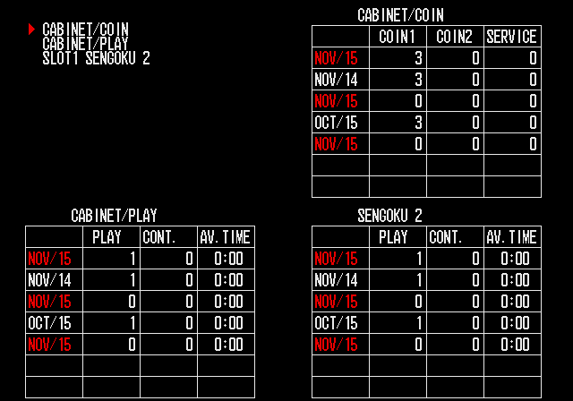
- **SETTING UP THE CODE NUMBER** stores a 4-digit code (`CodeNumber`); D with a memory card inserted
  writes it to a 1M card (below); a 2 KB card is refused (THIS CARD IS INVALID.).
- **EXIT** resets the board, after DIP-SW 1 OFF !! when the Setting Mode switch is still on.
- Right after the `jmp` to `CabinetSettings`, `$C19CF6-$C1A105` is an older 4-row version of the
  cabinet page (COIN RATE, GAME SELECT ONLY WHEN CREDITED / ANYTIME, ...) that nothing reaches
  (`CabinetSettingsOld`, C: no reference, never ran).

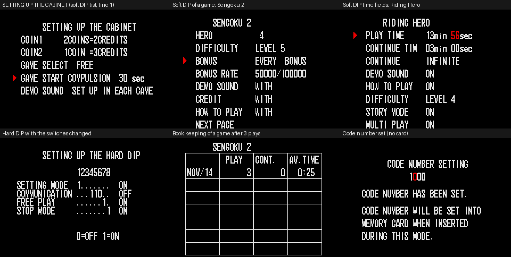

### Backup RAM map

The 64 KB backup RAM at `$D00000` (battery-backed on the MVS board) holds the board's settings, its
counters and up to 8 games (a game index per slot, `SlotTable`). Names in `symbols/ram.csv`; the code
reaches the upper half through a4 = `$D08000` (`BramA4Base`), written `(NAME-A4_BASE,a4)`.

| Address | Size | Content |
|---|---|---|
| `$D00000` | `$10` | start of the RAM test area (`BackupRamStart`) |
| `$D00010` | `$10` | `BackupRamSignature` (BACKUP RAM OK !): wrong at power-on = `ClearBackupRam`, which zeroes all 64 KB and writes the defaults |
| `$D00020-$D0003D` | | coin inputs (previous, current, new), coins toward a credit, coin counter pulses, `Credits` (BCD), `Credits2`, coin rates `Coin1Coins`.. |
| `$D00042-$D00047` | | cabinet settings: game select, start compulsion (flag, seconds, frames), demo sound; `SlotCount` |
| `$D00048-$D0005D` | | play time (seconds, frames), `EyecatchSlot`, the software clock (hour x 4, minute, second, frames) |
| `$D0005E-$D00061` | | `NeoClnSlot`, `SlotNumberMode` (cartridge ID cases) |
| `$D00104-$D00123` | | `LastBootDate`, `CurrentSlot`, `BookSlot`, book keeping pointers (today, month, game), day indexes |
| `$D00124` | `$40` | `SlotTable`: per slot, the NGH, the settings index and the date (+`$20`) |
| `$D00164` | `$40` | `RemovedGames`: games no longer in a slot |
| `$D001A4-$D001B1` | | game book keeping pointers, `CodeNumber`, `CabinetNumber` |
| `$D00200` | 8 x 4 | `BookGameDayCount`: days each game spent in a slot |
| `$D00220` | 8 x `$10` | `GameSoftDips`: soft DIP settings per game |
| `$D002A0` | 8 x `$10` | `GameNames`: game name per game |
| `$D00320` | 8 x `$1000` | `GameBackupData`: copy of each game's own backup area (`CART_BACKUP_PTR`) |
| `$D08320` | 8 x `$240` | `BookGameDays`: 36 daily records per game |
| `$D09520` | 8 x `$C0` | `BookGameMonths`: 12 monthly records per game |
| `$D09B20` | 8 x `$10` | `BookGameTotals` |
| `$D09BA0` | `$240` | `BookCoinDays`: CABINET/COIN, 36 days |
| `$D09DE0` | `$240` | `BookPlayDays`: CABINET/PLAY, 36 days |
| `$D0A020` | `$C0` | `BookCoinMonths`: 12 months |
| `$D0A0E0` | `$C0` | `BookPlayMonths`: 12 months |
| `$D0A1A0` | 8 x `$60` | `BookGameHours`: starts per hour of the day, per game (not shown by the test mode) |
| `$D0A4A0-$D0FFFF` | | no use found in the system ROM (only cleared with the rest) |

### 1M memory card: cabinet backup and recovery

The system ROM can keep a copy of each board's settings and book keeping on a 1 Mbit (64K x 16-bit)
RAM memory card, and put it back on a board whose backup RAM was lost (C: code read, then run in MAME
with an emulated card):

1. **Format**: in SETTING UP THE CODE NUMBER, D with the card inserted (`CodeNumberWrite`) tests the
   card's 64K words, writes `NEO-GEO` (one letter per word at +$40), the region, type `$20` (+$10),
   the code (+$70) and a cabinet count of 0 (+$74). A card already of type `$2x` only gets the code.
2. **Save**: during the title or demo, SELECT P1 with that card in a board whose `CodeNumber`
   matches (`Card1MSaveCabinet`, `$C12A18`): the board takes the next cabinet number
   (`CabinetNumber`, up to 10), and its date, `$D0011A` (`$25` words), `$D00200` (soft DIPs and game
   names) and `$D08320` (book keeping) go to +$100 + n x $2800 of the card. DATA HAS BEEN STORED AT A
   MEMORY CARD., then the game restarts.
3. **Recover**: power on with no cartridge, Service held and the card in (`$C11D66`):
   `Card1MRecover` shows CABINET No n and its saved slot list; Up/Down choose the cabinet; A+B+C+D
   held copy it back to backup RAM (`Card1MRestore`), RECOVER OK, then the board waits to be switched off.

MAME has only the 2 KB 8-bit card, which fails the 16-bit RAM test. `tools/mame_inputs.lua` emulates
a 1M card with memory taps (`CARD1M=<file>`, the 2 KB card stays inserted for the card-present bits)
and the MVS SELECT buttons, which MAME does not map (`P1 Select` in `KEYS`, a read tap on
`REG_STATUS_B`). With those, the system ROM code runs unchanged through the whole cycle (scenarios
`card1m_format`, `card1m_save_a`, `card1m_code_b`, `card1m_save_b`, `card1m_recover`).

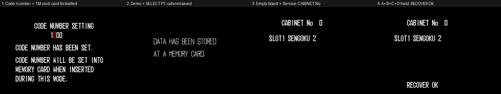

### Eyecatcher assets

The NEO-GEO / MAX 330 MEGA / SNK screen at boot (`Eyecatcher`, when the cartridge header byte
`$114` is 0) is put together from three places:

| Part | Where the graphics are | What the system ROM holds |
|---|---|---|
| NEO-GEO letters (sprites) | the cartridge's own sprite ROMs (C ROMs), tile bank = header byte `$115` (`CART_EYECATCH_BANK`); Sengoku 2: bank `$AF`, whose first rows are the letter pieces | which tile goes where (`EyecatchLogoTiles1/2`: low bytes, `$FF` = empty), the 18 sprite columns (`EyecatchSetSprites`), colours and fade (`EyecatchColourSets`), the animation (`EyecatchSteps`) |
| MAX 330 MEGA / PRO-GEAR SPEC | board fix ROM `sfix.sfix`, an 8x16 lettering whose pieces fill free cells of tiles `$005-$107` | `EyecatchTextTiles`: 32 characters of two tiles each, palette F, drawn one character every 4 frames |
| SNK logo (blue) | board fix ROM `sfix.sfix`, tiles `$200-$21F`, `$240`, `$25E` | `EyecatchFixMess` / `EyecatchFixTiles`: 3 rows of 10 tiles, palette F, at fix address `$71F6` |

So a game that leaves the eyecatcher to the system ROM must carry the NEO-GEO letters in its own
sprite ROMs; the rest ships with the board. Not checked: where the (R) mark comes from.

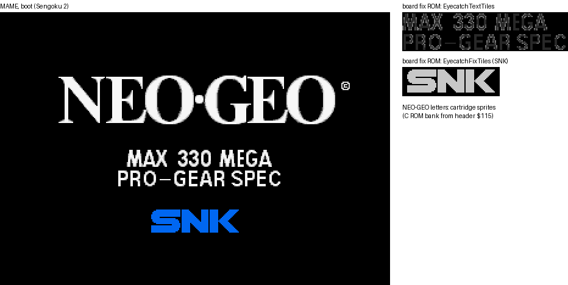

### Region screens after the eyecatcher

When the system ROM draws the eyecatcher, its last step looks at BIOS_COUNTRY_CODE: on an MVS with
code 1 (USA) it shows the FBI seal screen ("WINNERS DON'T USE DRUGS", `FbiScreen`), with code 0
(Japan) the warning THIS GAME IS FOR USE IN JAPAN ONLY. (`JapanOnlyWarningText`), each for 300
frames; with code 2 (Europe) it returns to the game at once. SP-S2 is European, so both screens are
in the ROM but never shown; they were run with the code forced when the step starts (scenarios
`eyecatcher_us` and `eyecatcher_japan`).

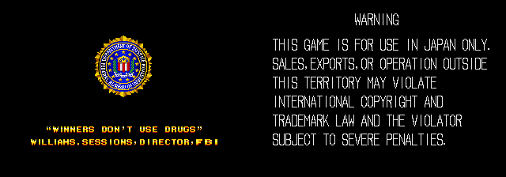

Only the layout of the FBI screen is in the system ROM: `FbiScreen` is a MESS_OUT list of fix-layer
tile numbers (`$B01-$B68` with palette 1, the seal by runs of increasing tiles, then the caption)
and `FbiScreenPalette` its colours. Before drawing it the code selects the board's fix ROM
(REG_BRDFIX), so the graphics come from `sfix.sfix`, the motherboard fix ROM of the MAME `neogeo`
set: tiles `$B00-$B68` hold the seal and a caption font with only the letters of WINNERS DON'T USE
DRUGS and WILLIAM S. SESSIONS, DIRECTOR, FBI. The JAPAN ONLY warning is plain text in the normal font.

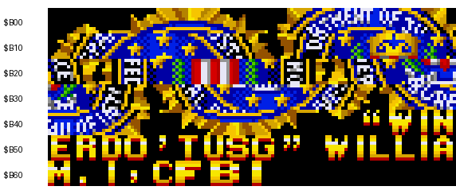

### Boot errors

The power-on tests (`PowerOnTest`) stop on `BootError` with an error number in `d6`. Each fault was
faked in MAME with a debugger breakpoint at the compare that detects it (`tools/fault_scenarios.py`,
scenarios `boot_error_*`: forced runs, they show what the code does when the fault happens):

| `d6` | Test | Screen |
|---|---|---|
| 0 | work RAM (`MemTestBlock`, patterns `$5555`, `$AAAA`, address) | WORK RAM ERROR, address, written and read words |
| 1 | backup RAM, only when `BackupRamSignature` is wrong | BACKUP RAM ERROR, address, written, read |
| 2, 3 | palette RAM banks | COLOR RAM BANK0 / BANK1 ERROR, address, written, read |
| 4 | video RAM (`VramTest`) | VIDEO RAM ERROR, address, written, read |
| 5 | VBlanks between two calendar pulses not 57-63 | CALENDAR ERROR |
| 6 | system ROM checksum | SYSTEM ROM ERROR |
| 7 | RAM test of an unformatted 2 KB card | MEMORY CARD ERROR |
| 8 | no reply from the Z80 (`Z80Check`) | Z80 ERROR |

On an AES (`SystemType` 0) the same errors fill the screen with one colour instead
(`AesErrorColours`: blue, red, green, yellow, magenta, cyan for 0-5; the table has no entry for 6-8).
With every hard DIP switch on at power-on, the work and backup RAM tests repeat under WORK RAM TEST
until a switch is turned off; the backup RAM is then cleared (`WorkRamTestLoop`, scenario
`work_ram_test_loop`, not forced).

Two leftovers sit in this code: an older copy of the power-on tests right after `SystemInt2`
(`PowerOnTestOld`, error numbers shifted by one) and a checksum routine that compares instead of
storing (`ChecksumCompare`); nothing reaches either.

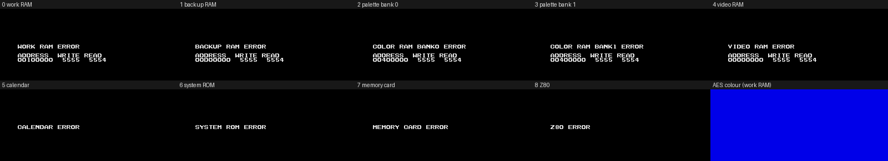

### Debug monitor

`$C16198-$C16AA9` is a debug monitor. Its eight entry points match the 68000 exceptions (MONITOR
ENTRY, ADDRESS ERROR, ILLEGAL INSTRUCTION, PRIVILEGE VIOLATION, TRACE, UNASSIGNED, UNINITIALIZED
INTERRUPT, SPURIOUS INTERRUPT): each saves the registers and the exception frame, shows the cause and
a register dump, and runs a command line. A picks the command (DISPLAY MEMORY, DISPLAY V-RAM, MODIFY
MEMORY, MODIFY V-RAM, MODIFY REGISTER, TRACE, RUN), Left/Right a digit, Up/Down its value, C runs it;
TRACE sets the trace bit and returns for one instruction, RUN returns from the exception (C).

In this release the exception vectors point to BIOS call slots (`$C00408-$C00432`) that all do
`jmp Reset`, so nothing reaches the monitor: a development build presumably jumped to it from those
slots. `tools/monitor_test.py` builds a test BIOS (MAME only) that does so and raises an exception
from test-menu item 4 (`illegal`, `address`, `privilege`, `trace` or `zerodiv`; scenarios
`monitor_*`).

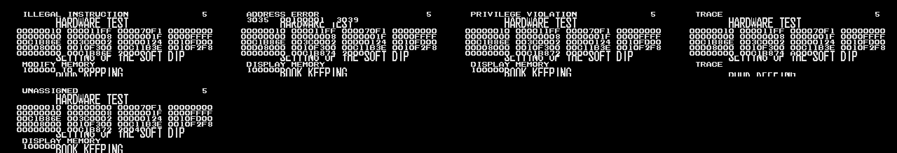

### Memory card errors

`CardError` (CARD_ERROR) turns the CARD result and function into a message (`CardErrorTable`): NO DATA
FOR THIS GAME., ERROR ON MEMORY CARD., MEMORY CARD WRITE PROTECTED. (PUSH ANY BUTTON., or 15 s on an
MVS), an unformatted card (an AES asks DO YOU WISH TO FORMAT?, an MVS formats at once) or a full card
(a page-by-page list of the data to delete). MAME has no write-protect switch: `MEMCARD_WP=1` in
`tools/mame_inputs.lua` sets the bit through a read tap. In the card utility (hidden-programs build),
COPY A DATA runs with two cards swapped as an operator would (`MEMCARD2`), and FORMAT and DELETE
answer MEMORY CARD WRITE PROTECTED. on a protected card (scenarios `card_util_*`).

What games do with a blank card (MAME, 29 sets, 3,000 frames of attract, coins and START, debugger
breakpoints on CARD and CARD_ERROR): every game reads the card title (function 5) at boot; at the
start most search for their data (function 1) or load it (function 2); eight games call CARD_ERROR
after a failed search, which shows nothing for that case; Mutation Nation formats the card itself
(function 0). League Bowling asks MEMORY CARD SAVE before the first frame: on a blank card CARD_ERROR
formats it and the save is repeated (`lbowling_card_format`), on a write-protected card it shows
MEMORY CARD WRITE PROTECTED. (`lbowling_card_write_protected`).

The full card: just before `Card` sits a loop that nothing calls and that had been typed as data,
`CardFillTest` (`$C132B4`): it saves $40 bytes with CARD 3 again and again (NGH $1234, file numbers
0-15, then the next NGH) until a CARD error, hands the error to CardError and stops there, a
development test that fills the card. Run from a test build (`tools/monitor_test.py OUT cardfill`,
scenarios `card_full_delete` and `card_full_exit`, forced), it fills a formatted 2 KB card in one
frame (27 saves); CARD returns $84 and CardError shows MEMORY CARD FULL with the data list, 6 lines a
page: A deletes the selected data and the save is repeated, B gives it up.

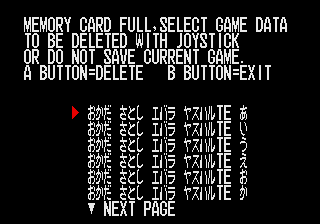

`CardDetect` knows three kinds of card: the 8-bit card (one byte per word, the only one MAME emulates),
a 16-bit card (type 1) and a 16-bit card that answers on every other word (type `$80`: address line A1
not decoded). Each kind has its own forms of the file system routines (`...Byte`, `...Word`,
`...Sparse`). The two others were run on cards emulated with memory taps (`CARD1M`, and
`CARD1M_SPARSE=1` for type `$80`, in `tools/mame_inputs.lua`): `CardFillTest` formats a blank card,
fills it, and deletes one save from the full list (scenarios `card_word_*` and `card_sparse_*`,
forced). The 16-bit card is found as `$4000` bytes. A blank type `$80` card in the slot at power-on
stops the boot with MEMORY CARD ERROR: the power-on test of an unformatted card fails on the aliased
words, so that card goes in after the boot.

### The ROMs of the MVS board

Besides the system ROM, three ROM chips sit on the MVS motherboard whatever the cartridge: the fix
tiles `sfix.sfix`, the Z80 sound program `sm1.sm1` and the sprite shrink table `000-lo.lo`, read by
the video hardware only. What each holds and which part of the board reads it:
[`docs/bios_set.md`](docs/bios_set.md). `make` rebuilds `sfix.sfix` from tile sheets and `000-lo.lo`
from its rule (row z of the table adds the source line bitreverse(z XOR `$11`)); `sm1.sm1` is
disassembled in `sm1/` and rebuilt with z80asm. The sound commands and when the board's Z80 program
runs: [`docs/sound.md`](docs/sound.md).

### Board fix ROM (sfix.sfix)

The system ROM draws its own screens with the fix-layer graphics ROM of the motherboard,
`sfix.sfix` (selected with REG_BRDFIX; REG_CRTFIX selects the cartridge's S ROM again). It is part of
the BIOS set (`neogeo.zip` in MAME), not of the game sets, so it is kept here as 16 tile sheets,
`gfx/sfix/bank_0.png` to `bank_F.png`: one bank of 256 tiles each, 16 x 16 tiles, indexed PNG whose
pixel values are the 4-bit colour numbers (grey palette; the real colours come from palette RAM).
`tools/sfix.py build` turns them back into the ROM and `make check` compares its SHA-1 (`make
sfix-source` regenerates the sheets from `roms/sfix.sfix`). What the tiles are, by range
(`symbols/sfix.csv`):

| Tiles | Content | Tag |
|---|---|---|
| `$000-$01F` | pieces of the eyecatcher lettering MAX 330 MEGA / PRO-GEAR SPEC (more in free cells up to `$107`) | C |
| `$020-$07F` | 8x8 ASCII font (boot errors, debug monitor, I/O check, controller test) | C |
| `$080-$0FF` | 8x16 kana, upper halves `$080-$0BF`, lower `$0C0-$0FF`: the Japanese texts | C |
| `$100-$1FF`, `$220-$2FF` | 8x16 font: upper halves at `$100`+c, lower halves at `$200`+c (MESS_OUT command 8, page 1: most BIOS texts) | C |
| `$200-$21F` | the blue SNK logo of the eyecatcher | C |
| `$300-$4FF` | a second 8x16 font with kana and kanji (`$316-$319`: the Japanese CODE NUMBER screen) | C |
| `$500-$6FF` | kanji (no SP-S2 list found using them) and the book keeping frame characters `$54E-$558`, `$580` | C |
| `$700-$77F`, `$800-$87F` | the HOW_TO_PLAY picture (panel, joystick, buttons A-D): upper halves at `$700`+n, lower halves at `$800`+n | C |
| `$780-$7FF`, `$880-$8FF` | 8x16 kana and kanji (upper and lower halves); no SP-S2 list found using them | I |
| `$900-$AFF` | 8x16 font of the HOW_TO_PLAY texts, written by the games (page 9) | C |
| `$B00-$B68` | the FBI screen: seal and caption letters | C |
| `$B69-$FFF` | unused (every byte `$FF`) | C |

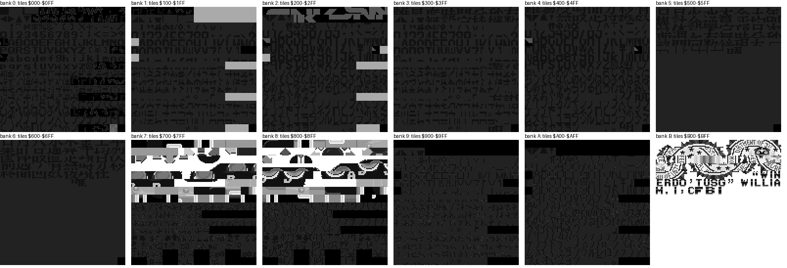

The HOW_TO_PLAY tiles were matched by replaying the system ROM's MESS_OUT lists on a model of the fix
layer (`tools/mess_render.py`); the result matches the MAME screen of NAM-1975:

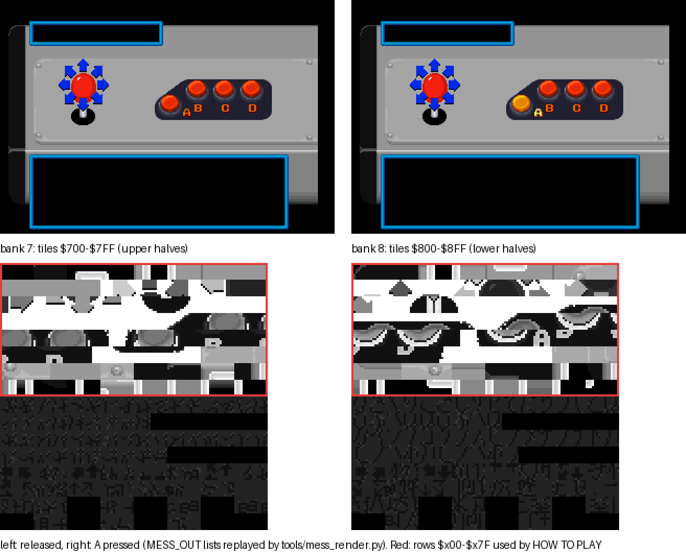

### NEO-CLN cartridges (cartridge calendar)

The slot scan (`CheckCartridgeId`, `$C12FFA`) accepts a game when its header ID reads `NEO-GEO`
and its security code matches 122 bytes of the system ROM's own card code (`$C146A2-$C1471B`).
A cartridge whose ID reads `NEO-CLN` is handled differently: it carries its own calendar chip, read
at `$220001` and controlled at `$280051` in the cartridge area. The BIOS stores its slot in
`NeoClnSlot` (`$D0005E`), copies the cartridge calendar to the board calendar and opens the
hardware test on its calendar screen; there, D sets the cartridge calendar and then the board
calendar. This is the only use of the "alternate" calendar routines (C). What such a cartridge
was used for is not documented; a service cartridge for setting the time is a guess (I).

In MAME, `tools/neo_cln_test.py` writes a copy of a game set with only the ID changed. MAME has no
chip there, so the time shown is open bus (scenario `neo_cln_cartridge`, D pressed at frame 600):

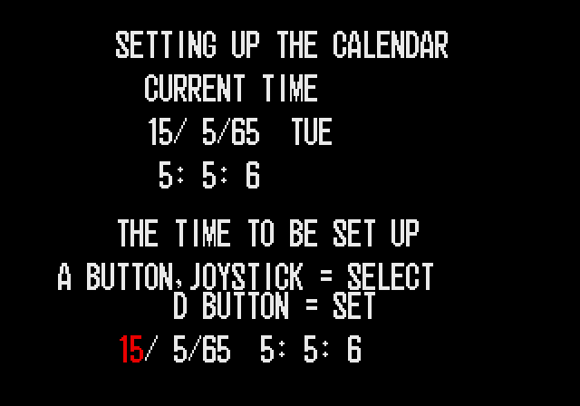

A third ID, the bytes `N 0 O 0 G 0 O 0` (the even letters of `NEO-GEO`, as a cartridge wired on one
byte lane would read: I), is accepted as a game and sets `SlotNumberMode` (`$D00060`) for this boot.
The BIOS then skips the boot animation and shows `SLOT n` for 300 frames before the game (SELECT P1
skips it), does not jump to the slot saved for the setting mode, keeps duplicate games in the slot
list, and lets SELECT end the demo without credits (C). Both special IDs also clear the start of
`BackupRamSignature` (`$D00010`, "BACKUP RAM OK !"), so the next boot clears the whole backup RAM
(book keeping and settings) and writes the defaults again (C: MAME, five boots sharing one nvram). MAME: `tools/neo_cln_test.py --nogo`,
scenario `nogo_cartridge`:

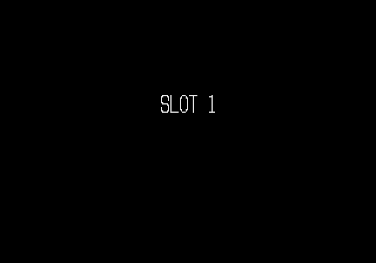

## Contents

| File | What it is |
|---|---|
| [`src/`](src/) | Generated 68000 source (GNU as, Motorola syntax), ROM addresses in comments, line comments from `symbols/comments.csv` on the boot, power-on tests, system modes, slot and Z80 switching, VBlank, coins and credits: `sp-s2.s` includes 14 modules (`header.s`, `tables.s`, `boot.s`, `system.s`, `power_on.s`, `calendar.s`, `card.s`, `boot_error.s`, `hardware_test.s`, `eyecatcher.s`, `video_io.s`, `how_to_play.s`, `test_mode.s`, `data_end.s`) |
| [`gfx/sfix/`](gfx/sfix/) | The board fix ROM `sfix.sfix` as 16 indexed tile sheets (`make` rebuilds it) |
| [`sm1/`](sm1/) | The board Z80 sound program `sm1.sm1`: `src/sm1.asm` (generated), `names.csv`, `hints.txt`, MAME coverage |
| [`tools/sm1.py`](tools/sm1.py), [`tools/z80dis.py`](tools/z80dis.py), [`tools/sm1_data.py`](tools/sm1_data.py) | Z80 decoder, tracer and source generator for `sm1.sm1` (with the sound data: headers, sequences, tables); build with z80asm and SHA-1 check |
| [`tools/mame_z80.sh`](tools/mame_z80.sh), [`tools/mame_z80.lua`](tools/mame_z80.lua) | Traced MAME run of the Z80: sound commands by frame, Z80 trace, WAV recording; can send commands |
| [`tools/check_repo.py`](tools/check_repo.py) | Consistency check of the repository (`make consistency`): symbol files, doubts, sources, document links and name/address pairs, stated counts, tools |
| [`tools/compare_bios.py`](tools/compare_bios.py) | Finds the named SP-S2 routines in another system ROM (addresses masked); results in `symbols/other_bios_routines.csv`, findings in [`docs/versions.md`](docs/versions.md) |
| [`tools/mess_render.py`](tools/mess_render.py) | Replays MESS_OUT lists of the system ROM on a fix layer model: tiles used, picture |
| [`tools/lo_rom.py`](tools/lo_rom.py) | The sprite shrink table `000-lo.lo` rebuilt from its rule (`make` builds it, `make check` compares it) |
| [`src/neogeo.inc`](src/neogeo.inc), [`src/ram.inc`](src/ram.inc) | Registers, cartridge header, `A5_BASE`/`A4_BASE`; every RAM address used |
| [`Makefile`](Makefile) | `make`, `make check`, `make fixsum`, `make source`, `make sfix-source` |
| [`HOWTO.md`](HOWTO.md) | Requirements, build, regeneration, trace hints, how to modify and test the BIOS |
| [`ROADMAP.md`](ROADMAP.md) | What is left for the disassembly, in order: coverage, names, RAM, written reference, other SNK ROMs |
| [`SKILL.md`](SKILL.md) | Working playbook: ROM facts, levels L0-L6, pipeline, pitfalls, rules |
| [`tools/trace.py`](tools/trace.py) | Recursive-descent tracer (Capstone): code, data and free bytes |
| [`tools/gen_source.py`](tools/gen_source.py) | Writes `src/` from the ROM and loops until the rebuild is identical |
| [`tools/symbols.py`](tools/symbols.py) | Loads and checks the names in `symbols/*.csv` (duplicates, tags) |
| [`tools/romtool.py`](tools/romtool.py) | Byte swap, SHA-1 check, boot checksum check and fix |
| [`tools/stats.py`](tools/stats.py) | Counts behind the level table |
| [`tools/hints.txt`](tools/hints.txt) | Manual tracer hints (the card utility pointer tables) |
| [`tools/mame_run.lua`](tools/mame_run.lua) | MAME autoboot script: headless screenshots, test mode, joystick taps |
| [`tools/mame_inputs.lua`](tools/mame_inputs.lua) | Inputs shared by the MAME scripts: key taps and holds, DIP switch changes, memory card insertion, the MVS SELECT buttons and an emulated 1M RAM card |
| [`tools/test_mode_scenarios.py`](tools/test_mode_scenarios.py) | Key sequences for every test-mode screen and the 1M card chain, run as coverage scenarios |
| [`docs/`](docs/) | Written reference, one page per subsystem ([`docs/README.md`](docs/README.md)), ROM byte maps and screenshots of the BIOS running in MAME |
| [`symbols/`](symbols/) | Names (`rom_names`, `ram`, `ram_scoped`, `registers`, `cart_header`), the fix ROM tile ranges (`sfix.csv`), named regions and module boundaries (`modules.csv`), tagged W / C / I / ?; `doubts.csv` lists every I name with how to settle it |
| [`coverage/`](coverage/) | Executed system ROM addresses of each MAME scenario (`tools/mame_coverage.sh`) |
| [`tools/coverage.py`](tools/coverage.py) | Compares MAME coverage with the static trace |
| [`tools/rom_map.py`](tools/rom_map.py) | Draws the ROM byte maps |
| [`tools/relocation_test.py`](tools/relocation_test.py) | Builds a modified BIOS with moved code and an added routine (L5 test) |
| [`tools/scan_bios_calls.py`](tools/scan_bios_calls.py) | Counts BIOS call references in game program ROMs |
| [`tools/mame_bot_sengoku2.lua`](tools/mame_bot_sengoku2.lua) | MAME play bot for Sengoku 2 (reaches level 2, card save/load) |
| [`tools/fault_scenarios.py`](tools/fault_scenarios.py) | Boot errors faked with debugger breakpoints, the all-DIPs RAM test loop, card errors and the card utility COPY (coverage scenarios) |
| [`tools/monitor_test.py`](tools/monitor_test.py) | Test BIOS whose exception slots jump to the debug monitor, with an exception raised from the test menu (MAME only) |
| [`tools/check_weekday.py`](tools/check_weekday.py) | Checks the weekday computed by `CheckCalendarDate` against the real calendar (1990-2089) |
| [`tools/sfix.py`](tools/sfix.py) | Board fix ROM: tile sheets in `gfx/sfix/` to `sfix.sfix` and back, SHA-1 check |
| [`tools/neo_cln_test.py`](tools/neo_cln_test.py) | Copies a game set with its header ID set to NEO-CLN, or `N 0 O 0 G 0 O 0` with `--nogo` (MAME only) |
| [`tools/hidden_programs_test.py`](tools/hidden_programs_test.py) | Builds a test BIOS whose test menu opens the unreferenced controller test and card utility |
| [`tools/mame_trace.lua`](tools/mame_trace.lua), [`tools/mame_coverage.sh`](tools/mame_coverage.sh) | Traced MAME runs (debugger trace through a FIFO; extra debugger commands with `DEBUG_CMDS`) |
| [`tools/mame_watch_irq2.lua`](tools/mame_watch_irq2.lua) | Logs a game's timer IRQ settings, vector switches and SystemInt2 runs |

The ROM is **not** in the repository (SNK copyright). Put your own dump in `roms/` (git-ignored).

## Building

```
make check    # build/sp-s2.sp1, SHA-1 must be 4f5ed7105b7128794654ce82b51723e16e389543
              # build/sfix.sfix, SHA-1 must be fd4a618cdcdbf849374f0a50dd8efe9dbab706c3
              # build/000-lo.lo, SHA-1 must be 5992277debadeb64d1c1c64b0a92d9293eaf7e4a
              # build/sm1.sm1, SHA-1 must be 42f9d7ddd6c0931fd64226a60dc73602b2819dcf
```

Needs Python 3 with `capstone`, GNU binutils for m68k (`binutils-m68k-linux-gnu`) and z80asm (`z80asm`). Details in
[`HOWTO.md`](HOWTO.md).

## Disassembly status

| Level | State |
|---|---|
| L0 source rebuilds the ROM | done: SHA-1 `4f5ed710...` and boot checksum `$4D`; 9,252 instructions, 2 kept as raw words because GNU as would encode them as `moveq` |
| L1 every byte typed | done by the tracer: code 32,966 B, data 21,383 B (text as `.ascii`, ROM pointers as `dc.l label`), free 76,723 B; three numeric tables identified (scaling tables at `$C02000`/`$C03000`, sine table at `$C04000`; C: tables for the games, docs/versions.md); the unreferenced controller test and memory card utility traced from their pointer tables, and the debug monitor from its 8 exception entry points (`tools/hints.txt`) |
| L2 code traced and run | 15 code-pointer tables followed; indirect jumps: `jmp (a6)` at `$C131A8` (return through a6 during the RAM test) the only one left (`tools/stats.py`); the card utility dispatch at `$C150A6` is found by the tracer. MAME, 88 scenarios with 10 games and with no cartridge (Sengoku 2: boot, coins and START, hardware test, every test-mode screen with every key and book keeping over three dates (`tools/test_mode_scenarios.py`), calendar set, memory card blank/formatted, played by a bot to level 2 then save, load and delete, and with its header ID patched to NEO-CLN or to N 0 O 0 G 0 O 0; the hidden-programs build: card utility with COPY between two cards, write-protected card, controller test; NAM-1975: HOW_TO_PLAY, and HOW_TO_PLAY with the timer interrupt forced on; Magician Lord: start; King of the Monsters 2: P2 join, continue, co-op start; King of the Monsters: co-op start; League Bowling: game type choice (CREDIT_DOWN), blank card (CARD_ERROR formats it), write-protected card; Riding Hero, Top Player's Golf, Alpha Mission II: soft DIP editor; Sengoku 2 and no cartridge: the 1M card cabinet backup with an emulated card; forced (`tools/fault_scenarios.py`): the 9 boot errors and the AES form, the debug monitor (test build, every command), the checksum slot and the card fill loop (test builds; also on emulated 16-bit and type $80 cards), CREDIT_DOWN in Top Player's Golf and Baseball Stars with the US country code, the FBI and JAPAN ONLY screens after the eyecatcher): 8,088 of 9,252 instructions ran (87.4 %), 6,563 without the forced runs; nothing ran outside the static trace. All 8 CARD functions and HOW_TO_PLAY ran; the work RAM test loop ran (all hard DIPs on). Never run: the monitor entries for MONITOR ENTRY, uninitialised and spurious interrupts, the older power-on tests (`PowerOnTestOld`), `ChecksumCompare` and the older cabinet page `CabinetSettingsOld` (219 instructions nothing reaches) |
| L3 names | 574 routines, tables and data blocks named (C 530, I 13, W 31) in `symbols/rom_names.csv`; every I and RAM I with its doubt and how to settle it in `symbols/doubts.csv`: the 17 BIOS call slots (wiki names, W) and their targets, and the 8 CARD functions; all ran in MAME (SYSTEM_INT2 only when forced, the checksum slot only from a test build); boot path, system modes and the hand-off to the game, VBlank and SYSTEM_IO, start buttons, credits and their deduction, slot switching, calendar chip (and the NEO-CLN cartridge calendar), test mode (every routine, table and text of `test_mode.s`), the 1M card cabinet backup, hardware test, the unreferenced controller test and memory card utility, the boot errors, the debug monitor, the card error handlers, the card format and file system helpers (three card types), the slot scan and slot table merge, coins and the software clock, the controller reading, the MESS_OUT command handlers, the most-called helpers (C from code reading, MAME screens and coverage); some I. Only the 1,039 `loc_` labels (branch targets inside routines) are still automatic: no `sub_`, `dat_` or `tbl_` left |
| L4 RAM and registers | done: no raw RAM, register or cartridge-header operand left; `x(a5)` written `(NAME-A5_BASE,a5)`; backup RAM through a4 = `$D08000` written `(NAME-A4_BASE,a4)`, a4 proven by the generator or, for the 8 cabinet row handlers reached through a table, by reading the callers (`a4` hints). All 274 RAM names used are defined (274 names over 227 addresses; 14 scoped rows reuse a name on another range): `symbols/ram.csv` has 160 names (W 60 from the NeoGeoDev wiki, C 90, I 10) and `symbols/ram_scoped.csv` 128 names valid in one part of the code only (`symbols/ram_scoped.csv`: the BIOS reuses `$10FC00-$10FD7F` and the card screen variables per screen). Backup RAM map above; 18 cartridge header fields named |
| L5 editable tree | done: 14 modules (`symbols/modules.csv`), no numeric ROM address left, free space as `.org`. Relocation proven in MAME (`tools/relocation_test.py`): with two NOPs at `Reset` and a new routine called from `TestMenu`, 38,961 bytes move and the BIOS still boots, plays the boot animation, starts Sengoku 2, runs the test menu (with the new line) and the hardware test |
| L6 understanding | started: boot sequence, every test-mode and hardware-test screen (with their settings), the 1M card cabinet backup, the hidden programs, card save/load/delete and card errors, boot errors, the debug monitor, HOW_TO_PLAY, CREDIT_DOWN and SYSTEM_INT2 run in MAME and linked to their routines (README sections above); screen texts match the ROM text tables (for example book keeping "CABINET/COIN" at `$C1AEB2`); written reference in [`docs/`](docs/README.md), 10 pages (boot, game contract, credits, calendar, memory card, test mode, interrupts, sound commands, the board ROMs, the other SNK versions) |

## Sources

- NeoGeoDev wiki: [System ROM](https://wiki.neogeodev.org/index.php/System_ROM), [BIOS calls](https://wiki.neogeodev.org/index.php/BIOS_calls),
  [Memory mapped registers](https://wiki.neogeodev.org/index.php/Memory_mapped_registers), [68k ASM defines](https://wiki.neogeodev.org/index.php/68k_ASM_defines),
  [BIOS RAM locations](https://wiki.neogeodev.org/index.php?title=BIOS_RAM_locations), [Boot process](https://wiki.neogeodev.org/index.php/Boot_process).
- [MAME `neogeo.cpp`](https://github.com/mamedev/mame/blob/master/src/mame/snk/neogeo.cpp): ROM hashes and board notes.
- [Capstone](https://www.capstone-engine.org/) (disassembly) and GNU binutils (assembly).
- Method from the [Game Boy Printer](https://github.com/Raphael-Boichot/Game-Boy-Printer-disassembly) and
  [Game Boy Camera](https://github.com/Raphael-Boichot/Game-Boy-Camera-disassembly) disassemblies (levels L0-L6, C / I / ? tags).

## Licence

The tools, labels, comments and documents are GPLv3 (`LICENSE`). The ROM contents, and so the
instructions and data in `src/sp-s2.s`, remain SNK's: they are not covered by that licence.
