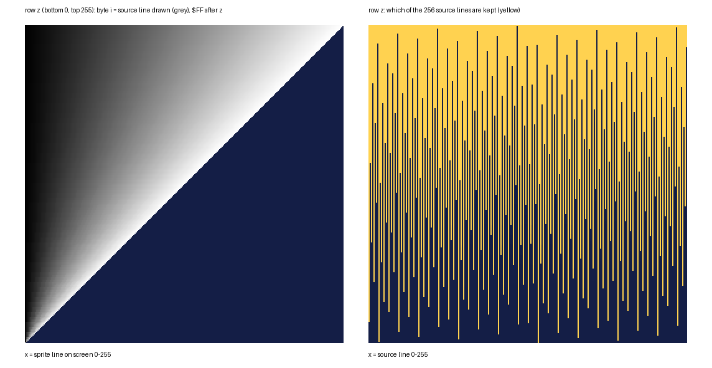

# The ROMs of the MVS board

MAME's `neogeo.zip` holds the system ROMs of many boards and three more ROMs that sit on the MVS
motherboard whatever cartridge is in. With the system ROM they are the board's own software and data.
Tags: **C** checked here (code, dump, MAME), **W** public reference (NeoGeoDev wiki), **I** inferred.

## Four ROMs, four chips

On a multi-slot MVS motherboard each of these is its own ROM chip (W: wiki pages System ROM, SFIX,
SM1, L0 ROM). They are read by different parts of the board:

| Dump | Content | Size used (dump) | Read by | Selected by | In this repository |
|---|---|---|---|---|---|
| `sp-s2.sp1` | system ROM: the 68000 program this repository disassembles | 128 KB (128 KB, 16-bit words byte-swapped) | 68000 at `$C00000`; its vector table at `$000000` after `REG_SWPBIOS` | always mapped | `src/`, rebuilt byte for byte (`make check`) |
| `sfix.sfix` | board fix layer tiles: the font and pictures of the system screens | 128 KB (128 KB) | video chips, fix layer | `REG_BRDFIX` (`$3A000B`); `REG_CRTFIX` gives the cartridge's S ROM back | `gfx/sfix/`, 16 tile sheets, rebuilt byte for byte |
| `sm1.sm1` | board sound program for the Z80, used while the board ROMs are selected (the system screens) | 64 KB (128 KB: the same 64 KB twice, C) | Z80 | `REG_BRDFIX` too ("Use the embedded SFIX ROM and SM1 ROM", W); `REG_CRTFIX` gives the cartridge's M1 ROM | not yet (ROADMAP step 7) |
| `000-lo.lo` | L0 ROM: the sprite vertical shrink table | 64 KB (128 KB: the same 64 KB twice, C) | video hardware, for every sprite line drawn | not switched | `tools/lo_rom.py`, rebuilt from its rule (below) |

So yes, separate chips, and they are not all for the 68000: the system ROM is program code, the fix
ROM is graphics, `sm1.sm1` is the sound CPU's program, and the L0 ROM is a table that only the video
hardware reads (no CPU can see it).

Other systems differ (W):

- AES (home console): no SFIX and no SM1; the fix tiles and the Z80 program always come from the
  cartridge. It has its own L0 ROM.
- MV1C and some later boards: the L0 ROM is built into the NEO-GRZ video chip (wiki: NEO-GRZ
  "integrates ... the L0 ROM").
- CD systems: no SFIX and no SM1, but an L0 ROM.
- SM1 is found "in some MVS systems" and SFIX "in most MVS boards" (wiki wording).

The other system ROMs of `neogeo.zip` (other regions, AES, later revisions) are for ROADMAP step 6.

## sm1.sm1 (Z80 sound program)

64 KB, stored twice in the 128 KB dump (the halves are equal, C). It carries the text
`Ver 1.5b by Mr.Pac h Ber.02/01/08` (C; the same signature as the wiki's SM1 page). The system ROM
talks to it through `REG_SOUND`: command 1 before a slot switch (`SoundSlotSwitch`, reply 1), 3 when it
hands over to a game (`CallUser`), `$7F` for the coin sound on system screens, and the sound test
commands. What each command plays, and whether the eyecatcher music comes from this ROM or from the
cartridge's M1, is ROADMAP step 7.

## 000-lo.lo (sprite shrink table)

256 rows of 256 bytes, one row per vertical shrink value `z` of a sprite (0 = smallest, 255 = full
size). A byte is a sprite line number 0-255: high nibble the tile of the sprite column, low nibble the
pixel row in that tile (W: L0 ROM). Row `z` lists the `z + 1` source lines that are drawn, in order,
and `$FF` after them. The hardware reads the table backwards for the lower half of a 512-line sprite
(W).

The whole table follows from one rule, found from the dump and checked on every byte (C): going from
row `z - 1` to row `z` adds one source line, the 8-bit bit-reversal of `z XOR $11`. Row 0 draws only
line `$88`, row 1 adds `$08`, row 2 `$C8`, row 3 `$48` ... and row 255 is `$00, $01 .. $FF`. Lines
are added in bit-reversed order, so the kept lines stay evenly spread at every size.

`tools/lo_rom.py build` writes the 128 KB ROM from this rule, `make check` compares its SHA-1
(`5992277d...`, CRC32 `5A86CFF2`, the wiki's values) and `tools/lo_rom.py verify` compares a dump row by
row.

## Sources

NeoGeoDev wiki: System ROM, SFIX, SM1, L0 ROM, NEO-GRZ, Memory mapped registers (`REG_BRDFIX`,
`REG_CRTFIX`); the dumps in MAME 0.264's `neogeo.zip`.
