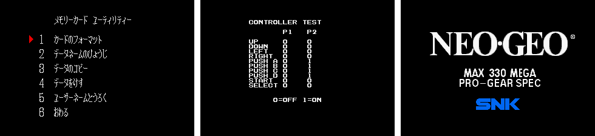

# What the other SNK system ROMs tell about SP-S2

The other SNK system ROMs are not disassembled here. They are used to understand SP-S2: whether a
routine of SP-S2 is common to every version or special to it, and what the code that SP-S2 never runs
was for. Tags: **C** checked (bytes, references, MAME), **W** public reference, **I** inferred.

## The ROMs compared

All 18 other SNK system ROMs of MAME 0.264's `neogeo.zip` (and its AES set), named by MAME's BIOS
options. `tools/compare_bios.py` traces each one and looks for every named SP-S2 routine (306 of 4
instructions or more), ROM addresses masked; `symbols/other_bios_routines.csv` holds the result.

| File | MAME BIOS | Header: type, region | SP-S2 routines identical / changed / not found |
|---|---|---|---|
| `sp-e.sp1` | US MVS (Ver. 1) | MVS, US | 293 / 5 / 8 |
| `sp-u2.sp1` | US MVS (Ver. 2?) | MVS, US | 289 / 7 / 10 |
| `sp-s.sp1` | Europe MVS (Ver. 1) | MVS, Europe | 280 / 10 / 16 |
| `sp-s3.sp1` | Asia MV1B | MVS, Europe | 270 / 16 / 20 |
| `sp1-u4.bin` | US MVS (U4) | MVS, US | 269 / 13 / 24 |
| `sp1-u3.bin` | US MVS (U3) | MVS, US | 266 / 14 / 26 |
| `sp1-u2` | US MVS (4 slot, Ver 2) | MVS, US | 265 / 15 / 26 |
| `sp-j2.sp1` | Japan MVS (Ver. 2) | MVS, Japan | 253 / 35 / 18 |
| `sp-45.sp1` | Asia NEO-MVH MV1C | MVS, Europe | 250 / 21 / 35 |
| `sp1.jipan.1024` | Japan MVS (Ver. 1) | MVS, Japan | 237 / 36 / 33 |
| `sp-j3.sp1` | Japan NEO-MVH MV1C | MVS, Japan | 234 / 36 / 36 |
| `sp1-j3.bin` | Japan MVS (J3, alt) | MVS, Japan | 233 / 38 / 35 |
| `vs-bios.rom` | Japan MVS (Ver. 3) | MVS, Japan | 226 / 40 / 40 |
| `sp-1v1_3db8c.bin` | Custom Japanese Hotel | MVS, Japan | 223 / 47 / 36 |
| `japan-j3.bin` | Japan MV1B | MVS, Japan | 217 / 41 / 48 |
| `neo-epo.bin` | AES Asia | AES, Europe | 211 / 7 / 88 |
| `neo-po.bin` | AES Japan | AES, Japan | 168 / 34 / 104 |
| `neodebug.bin` | AES Development System ROM | AES, Japan | 160 / 42 / 104 |

"Changed" is a match of 0.8 to 0.99 (some instructions differ); "not found" includes routines that
were rewritten. SP-S2 is closest to the first US and European MVS versions. The MV1B and MV1C
versions start their code at `$C10000` instead of `$C11000`.

## Findings about SP-S2

**The hidden programs are the AES boot menus (C).** `ControllerTest` and `CardUtility` are referenced
by no MVS ROM, SP-S2 included, but every AES ROM jumps to them from its start-up code: A+B+C+D held
on controller 1 opens the memory card utility, on controller 2 the controller test. Seen in MAME (AES,
Japan BIOS, A-D held from power-on):

So SP-S2 carries the AES menus in code shared by all versions, with no way in on an MVS.

**The debug monitor is the exception handler of two versions (C).** The exception slots of the
Development System ROM and of the Custom Japanese Hotel ROM jump into the monitor
(`MonitorEntry`, `MonitorAddressError`, `MonitorIllegal`, ...); in every other ROM, SP-S2 included,
they jump to `Reset`. Those two are also the only ROMs where the bus error slot is not `jmp Reset`, so
they skip the system ROM checksum test: the test in `PowerOnTest` that looks at that slot was meant
for monitor builds (docs/boot.md). MAME's AES development set has a jumper input named "Short JP1
(Debug Monitor)".

**`ScaleTableA`, `ScaleTableB` and `AbsSineTable` are for the games (C).** The three tables are
byte for byte the same at `$C02000`, `$C03000` and `$C04000` in all 19 ROMs, even in the versions
whose code moved, and no system ROM reads them. 15 of the 29 games of this project load them with
`lea $C02000` / `$C03000` / `$C04000` (`$C04200` too); in MAME Sengoku 2 read them 6,457, 6,457 and
2,537 times in its first 2,400 frames. They are a service of the system ROM at fixed addresses, like
the BIOS calls.

**Leftovers common to every version (C).** `CardFillTest`, `ChecksumCompare`, the debug monitor
routines and the six `HwCalendarFixAddresses` words exist in every ROM and nothing refers to them
outside the two monitor ROMs. `CabinetSettingsOld` is unreferenced everywhere except by one long
pointer in the development ROM (`$C184A4` there; not followed).

**`SystemIoTestWord` is an MVS switch that never switches (C for the code; its purpose is unknown).**
Every MVS version has the same `tst.w` of a word `$0001` followed by a `bne` to the next instruction;
the AES and development versions have no such test. The later Japanese and MV1B/MV1C versions add a
call before it.

**The Magician Lord patch is in every MVS version (C).** The test of NGH `$0005` with the cabinet's
DEMO SOUND (`NextSlot`, docs/game_contract.md) is in all 15 MVS ROMs, and in none of the AES ROMs,
which have no cabinet settings.

**Unchanged in every version (C).** `LoadGameSoftDips` copies 12 option nibbles in all 18 other ROMs
too: not an SP-S2 slip. The word `CardFormat` writes as the card format version is `$0000` at the
start of the code in every version. `HowToPlayFlag` is only ever cleared, `Card1MRecoverFlag` only
ever written, and `Credits2` is read by the LED code and written by no SNK system ROM.

## The unused parts of SP-S2

What no path of SP-S2 reaches, found by following every call, jump, branch and pointer from the
vectors and the BIOS call table (labels and fall-through), plus the code bytes after an `rts` and the
data after a `bra`; then each piece looked up in the 18 other ROMs (C: bytes and references;
`tools/compare_bios.py` for named routines, the same masked search for the rest).

| Address | Size | What | In the other versions |
|---|---|---|---|
| `$C00480-$C004C1` | 66 | 11 BIOS call slots that jump to an `rts` | the same in all 19 ROMs: reserved slots |
| `$C02000-$C042FF` | 8,960 | `ScaleTableA`, `ScaleTableB`, `AbsSineTable` | read by the games, not by any system ROM (above) |
| `$C118DC-$C11A6D` | 402 | `PowerOnTestOld` | the AES power-on test: the three AES ROMs branch to it from `Reset` when the cartridge header check fails (no NEO-GEO at `$100`, or a bad security block at the pointer `$182`), so with no game; it ends in a boot error because there is nothing to boot. Unreferenced in every MVS ROM |
| `$C126C4-$C126E9` | 38 | in `SystemIoMvs`: a slot LED cycle (every 4 frames, the next slot) | skipped by a `bra` in SP-S2 and 13 other MVS ROMs; a `bne` in US U3 and Japan J3 alt, where it runs while the status is 1 (eyecatcher); absent from the AES ROMs |
| `$C132B4-$C1334B` | 152 | `CardFillTest` | a leftover common to every version (above) |
| `$C14EA2-$C16197` | 4,854 | `ControllerTest`, `CardUtility` | the AES boot menus (above) |
| `$C16198-$C16AA9`, `$C16DCE-$C1705F` | 2,980 | the debug monitor and its texts | the exception handler of the development and hotel ROMs (above) |
| `$C16C42-$C16C6D` | 44 | `ChecksumCompare` | as `CardFillTest` |
| `$C17BFA`, `$C199A8` | 2 x 12 | `HwCalendarFixAddresses` and a second copy `CalendarFixAddresses` (jumped over by a `bra.w` in `TestCalendar`): six fix positions on rows `$17` and `$1A` | both copies in every ROM but the development ROM (one copy), referenced in none |
| `$C1849C-$C184EB` | 80 | `ControllerTypeScan`, code after the `rts` of `ControllerSetup` | called 6 times by `ControllerSetup` in the three AES ROMs, after each `REG_POUTPUT` pattern: the controller type detection; unreferenced in every MVS ROM, where `ControllerSetup` only reads the mahjong DIP |
| `$C19884-$C1988F` | 12 | `HardDipCoin2Text`, `HardDipCoin4Text` (2, 4) | the COIN SWITCH row (hard DIP 2) of the US hard DIP page: referenced in US Ver. 1, U4 and U3; present and unreferenced in US Ver. 2?, Europe Ver. 1, Asia MV1B, Asia MV1C and AES Asia; absent from the others |
| `$C19CF6-$C1A105` | 1,040 | `CabinetSettingsOld` | as above |
| `SystemIoTestWord` | 2 | a test whose branch goes to the next instruction | every MVS version (above) |

Apart from the tables for the games, about 9,700 of the 54,349 bytes of code and data of SP-S2 are
never reached, and most pieces have a user in some other version: SP-S2 is built
from the code shared by the AES and MVS system ROMs, with the AES-only parts (power-on test without a
cartridge, controller detection, boot menus) left in place. The slot LED cycle and the COIN SWITCH row
are MVS features that other MVS versions use.

## What SP-S2 changed against its closest relatives

41 SP-S2 routines differ from at least one of US MVS Ver. 1 (`sp-e`), US MVS Ver. 2? (`sp-u2`) and
Europe MVS Ver. 1 (`sp-s`); only 2 differ from all three (`HwTestIoCheck`, `CardUtilMoveMenuCursor`, a
moved RAM variable). The differences fall into two groups.

**Against the US versions: one credit pool instead of one per player (C).** The US versions count
credits per player: coin slot 1 credits player 1 (`Credits`), coin slot 2 player 2 (`Credits2`), the
service switch adds one to each, and a start takes from the player's own counter. SP-S2 (and the first
European version) put every coin and service credit in `Credits` alone. MAME, Sengoku 2, coin 1, coin 2
twice, service: US BIOS `Credits` 2 / `Credits2` 2, European BIOS `Credits` 4 / `Credits2` 0. This
explains `Credits2`: SP-S2 kept the code that reads it (the second LED, the start compulsion) but no
longer writes it. The routines concerned: `CountCoin`, `CountService`, `StartCreditCheck`,
`CreditCheckPlayer`, `CreditCheck`, `DeductStartCredits`, `DeductPlayerCredit`, `CreditDownCount`,
`SystemIoMvs`. US Ver. 2 also has, in `PlayTimeCount`, a call that runs only for NGH `$0002`
(Baseball Stars Professional) and reads the game's RAM: a game patch SP-S2 does not have (I: not
followed).

**Against the first European version: features SP-S2 added (C for the code; the purpose from the
code).** Europe Ver. 1 lacks these, and both US versions already have them:

| Area | In SP-S2, not in Europe Ver. 1 |
|---|---|
| slots | the slot count from the board (`REG_SYSTYPE` bit 6 and `REG_STATUS_A` bit 5: 2, 4 or 6 slots, `SlotCount`) used by `PowerOnSetup`, `RegisterNewGame`, `BookNewDayPerGame` |
| slot table | the merge of the new scan with the stored table: removed games listed, moved games keep their settings, new games dated (`SlotListRemoved`, `SlotKeepOuterEntries`, `SlotCopyMovedSettings`, `SlotTableStore`, `SlotDateNewGames`) |
| book keeping | the TOTAL line and the per-game totals record on the game pages (`BookGame`, `BookPutTotal`, `BookGameTotals`), the months total of the PLAY page (`BookDrawPlayMonthsTotal`) |
| 1M memory card | the cabinet list and restore on power-on (`IsCard1M`, `Card1MDrawSlots`, `Card1MRecoverDraw`, `Card1MRestore`); Europe Ver. 1 has a simpler `Card1MRecover` |
| hardware test | the system bits on the I/O check screen (`HwTestIoCheck`, `IoCheckPutSystemBits`) |
| hard DIP page | a table-driven list of the settings (`HardDipDraw`) |

The rest are small: a backdrop colour taken from a ROM word, an `andi.w #$FF` added in `NextSlot`, RAM
variables moved.

## What the system type and the region change in SP-S2

SP-S2's header says MVS (`SystemType` `$80`) and Europe (`SystemRegion` 2). `Reset` copies the two bytes
to `BIOS_MVS_FLAG` and `BIOS_COUNTRY_CODE`; the test mode, the hardware test and `Card1MRecover` set them
again (MVS, `SystemRegion`). Games may change the country code (Top Player's Golf and Baseball Stars
copy it). 33 instructions of SP-S2 read or set them (C, all read in the code; the region screens and the
two games run in MAME with the code forced):

| Byte | Value | What changes |
|---|---|---|
| system type | AES (0) | no coins, credits, LEDs, book keeping or play time (`SystemIoMvs`, `StartCreditCheck`, `CreditCheck`, `SystemIo`); a START always starts |
| | | eyecatcher: A-D or START skips it; on an MVS credits skip it instead; its music always plays (on an MVS only when DEMO SOUND is not WITHOUT) |
| | | memory card: an unformatted card asks DO YOU WISH TO FORMAT? instead of formatting; messages wait for a button instead of 15 seconds |
| | | HOW_TO_PLAY returns at once: it is an MVS-only service |
| | | boot errors: one colour per error instead of a text (`AesErrorColours`) |
| region | 0 Japan, 1 USA, 2 Europe | the soft DIP block of the cartridge used (`CART_SOFTDIP_JP/US/EU`): game names, settings pages (`GetSoftDipPointer`, `RegisterNewGame`, `SoftDipEditor`) |
| | | the region byte written in the header of a formatted memory card and of a 1M cabinet card |
| | 0 Japan | Japanese texts: YOUR CARD IS STILL INSERTED, SAVE OK, the CODE NUMBER screens |
| country code | 1 USA, MVS | the FBI screen after the eyecatcher |
| | 0 Japan | the JAPAN ONLY screen after the eyecatcher |

So the same SP-S2 code covers both systems and three regions; the European header only selects
European texts and soft DIP pages, and no region screen.

## How to redo it

    python3 tools/compare_bios.py <other ROMs...> --csv out.csv     every named routine
    python3 tools/compare_bios.py --name SystemIo <other ROMs...>    one routine, differences listed

## Sources

MAME 0.264 BIOS list (`mame -listbios neogeo`, `aes`) and its ROM dumps; NeoGeoDev wiki: System ROM
(header bytes `$400`/`$401`); the game program ROMs of the project's MAME sets.
